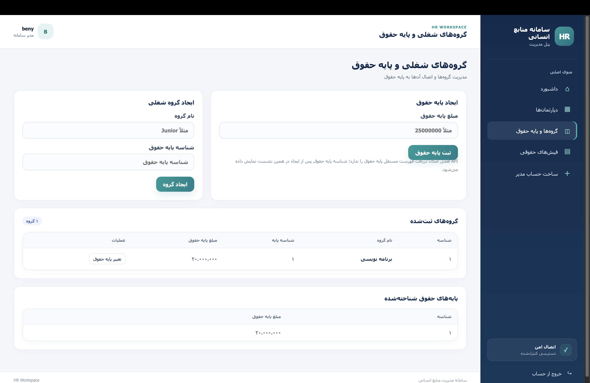
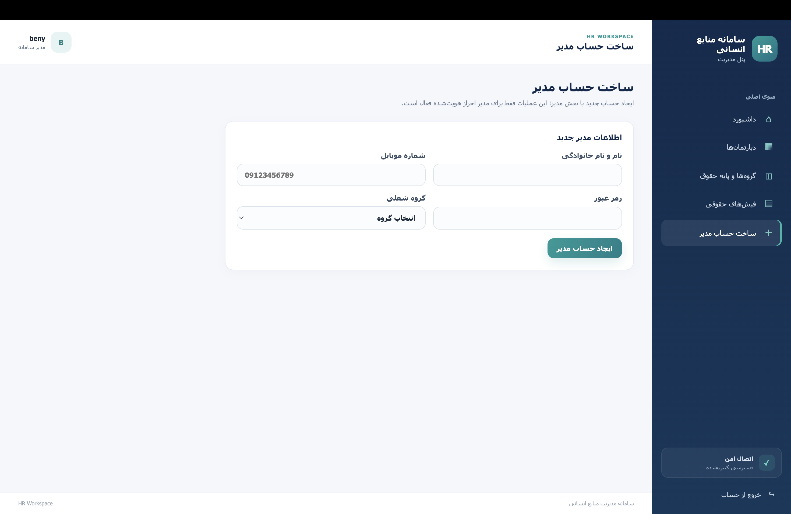
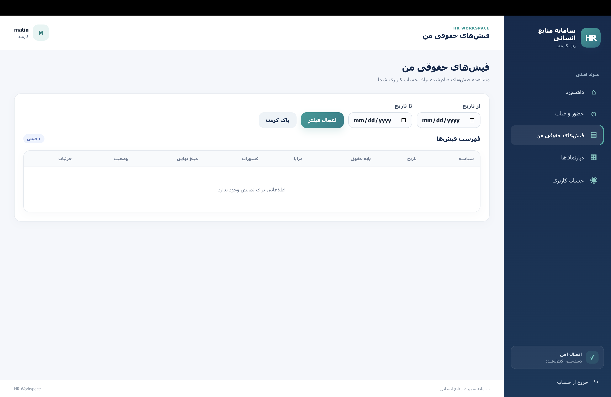

# HR Workspace — Human Resource Management System

A full-stack Human Resource Management System built with **NestJS, TypeScript, PostgreSQL, and Redis**, featuring role-based access control and dedicated workspaces for managers and employees.

HR Workspace provides a centralized platform for managing organizational departments, employee groups, salary structures, payroll operations, and attendance records through a web-based interface.

---

## Screenshots

### Manager Workspace

| Dashboard | Departments | Groups & Salary Grades |
|:---:|:---:|:---:|
|  |  |  |

| Payroll Management | Create Manager Account |
|:---:|:---:|
|  |  |

### Employee Workspace

| Dashboard | Attendance |
|:---:|:---:|
|  |  |

| Payroll | Account |
|:---:|:---:|
|  |  |

---

## Key Features

### Authentication & Authorization
- User registration and authentication.
- JWT-based authentication.
- Access and refresh token management.
- Secure refresh token storage using signed HTTP-only cookies.
- Role-based access control for managers and employees.
- Protected endpoints using authentication and role guards.
- Dedicated authorization rules for different user roles.

### Manager Workspace
- Manager dashboard.
- Department management with CRUD operations.
- Employee group and salary grade management.
- Payroll management and filtering.
- Manager account creation.
- Access-controlled management operations.

### Employee Workspace
- Employee dashboard.
- Attendance check-in and check-out.
- Attendance records and filtering.
- Personal payroll information.
- Department information.
- Employee account management.

### Backend Architecture
- Modular architecture using NestJS modules.
- Separation of controllers and business logic through services.
- DTO-based request validation.
- Centralized response handling through a custom interceptor.
- Centralized exception handling through a custom exception filter.
- Global API version prefix.
- API documentation with Swagger.

### Testing
- HTTP-level end-to-end testing with Jest and Supertest.
- Controller and endpoint testing.
- Request validation testing.
- Role-based authorization testing.
- Response and exception handling testing.

---

## Technology Stack

| Category | Technologies |
|---|---|
| Backend Framework | NestJS |
| Programming Language | TypeScript |
| Web Platform | Express.js |
| Template Engine | EJS |
| Database | PostgreSQL |
| ORM | TypeORM |
| In-memory Data Store | Redis |
| Authentication | JWT |
| Password Hashing | bcrypt |
| Validation | class-validator, class-transformer |
| API Documentation | Swagger |
| Testing | Jest, Supertest |
| Package Manager | npm |

---

## Architecture Overview

The application follows a modular backend architecture based on NestJS.

```text
Client / Browser
       |
       v
  Express.js + EJS
       |
       v
   NestJS Application
       |
       +----------------------+
       |                      |
       v                      v
 Authentication          API Controllers
       |                      |
       v                      v
 JWT / Role Guards       DTO Validation
                              |
                              v
                         Services
                              |
                    +---------+---------+
                    |                   |
                    v                   v
                TypeORM              Redis
                    |
                    v
                PostgreSQL
```

### Main Modules

- **Auth Module:** Authentication, registration, token management, and authorization.
- **Department Module:** Department management and employee department access.
- **Attendance Module:** Employee attendance operations.
- **Payroll Module:** Payroll management and employee payroll access.
- **Web Module:** Server-rendered application pages using EJS.

---

## API Overview

The REST API uses the following global prefix:

```http
/api/v1
```

### Authentication

| Method | Endpoint | Description |
|---|---|---|
| POST | `/api/v1/auth/register` | Register a new employee |
| POST | `/api/v1/auth/login` | Authenticate a user |
| POST | `/api/v1/auth/create-manager` | Create a manager account |
| POST | `/api/v1/auth/refresh/user/:id` | Refresh user authentication |

### Department Management

| Method | Endpoint | Description |
|---|---|---|
| POST | `/api/v1/manager-data/departments` | Create a department |
| GET | `/api/v1/manager-data/departments` | Retrieve all departments |
| GET | `/api/v1/manager-data/departments/:id` | Retrieve a department |
| PATCH | `/api/v1/manager-data/departments/:id` | Update a department |
| DELETE | `/api/v1/manager-data/departments/:id` | Delete a department |

### API Documentation

Swagger documentation is available through separate manager and employee documentation interfaces:

- Manager API: `/api/manager`
- Employee API: `/api/employee`

---

## Getting Started

### Prerequisites

Make sure the following tools are installed:

- Node.js
- npm
- PostgreSQL
- Redis

### Installation

Clone the repository:

```bash
git clone <YOUR_REPOSITORY_URL>
cd hr
```

Install dependencies:

```bash
npm install
```

### Environment Configuration

Create a `.env` file in the project root and configure the required application settings.

The configuration should include your database connection, authentication secrets, cookie configuration, Redis connection, and application port.

Never commit your actual `.env` file or expose credentials in the repository.

### Run the Application

Start the application in development mode:

```bash
npm run start:dev
```

The application will be available at the configured local address.

---

## Project Structure

```text
src/
├── common/
│   ├── filter/
│   ├── interceptors/
│   └── ...
│
├── module/
│   ├── auth/
│   ├── attendance/
│   ├── department/
│   └── payroll/
│
├── shared/
│   └── enums/
│
├── views/
│   ├── auth/
│   ├── errors/
│   └── ...
│
├── public/
│   ├── css/
│   └── js/
│
├── app.module.ts
└── main.ts

test/
screenshots/
README.md
```

---

## Author

**Benyamin Haghighy**

Backend Developer | Node.js · TypeScript · NestJS

- GitHub: [@benyamin-haghighy](https://github.com/benyamin-haghighy)
- Email: bng2003@gmail.com

---

**HR Workspace** — A centralized platform for human resource management.