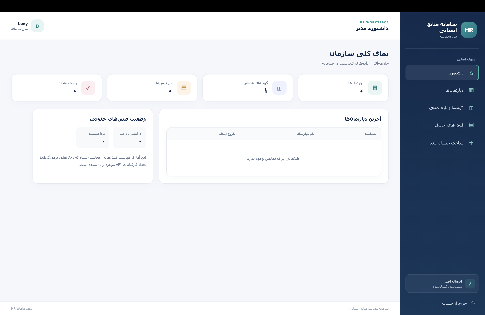
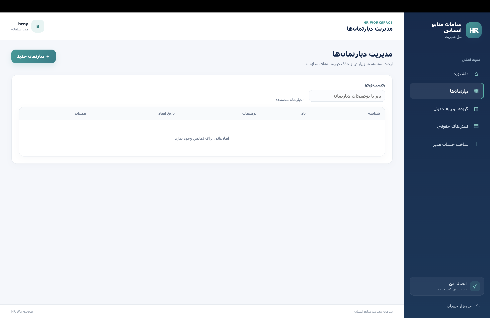
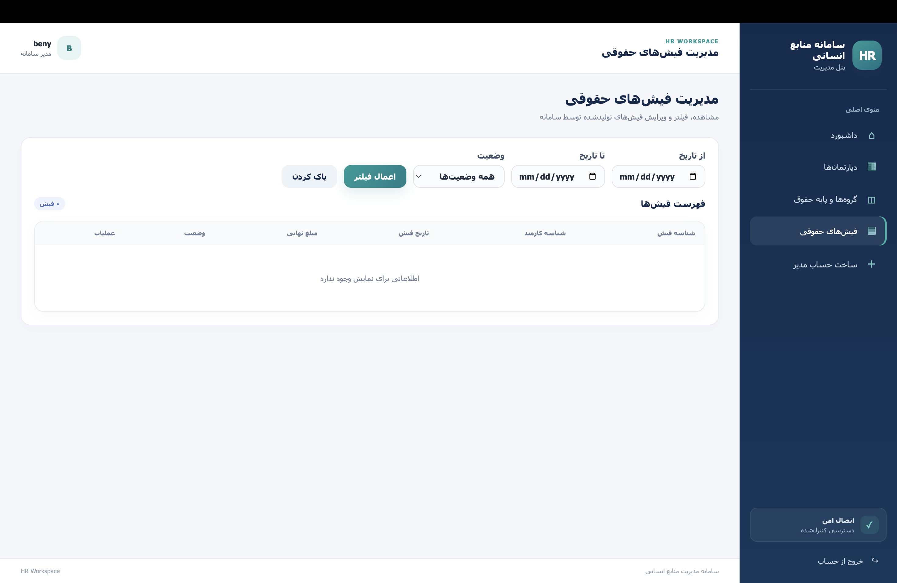
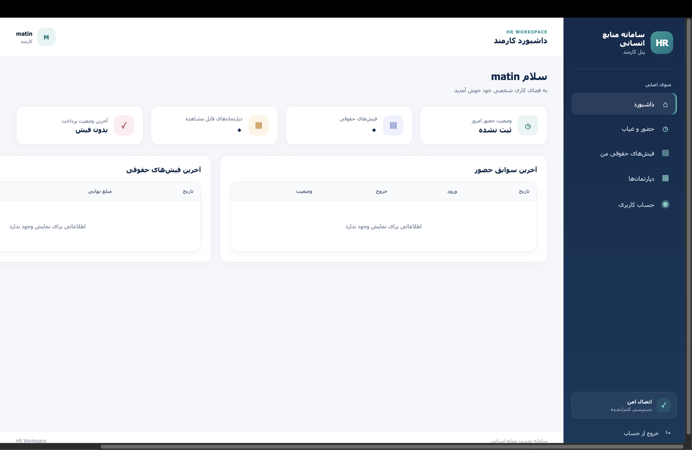
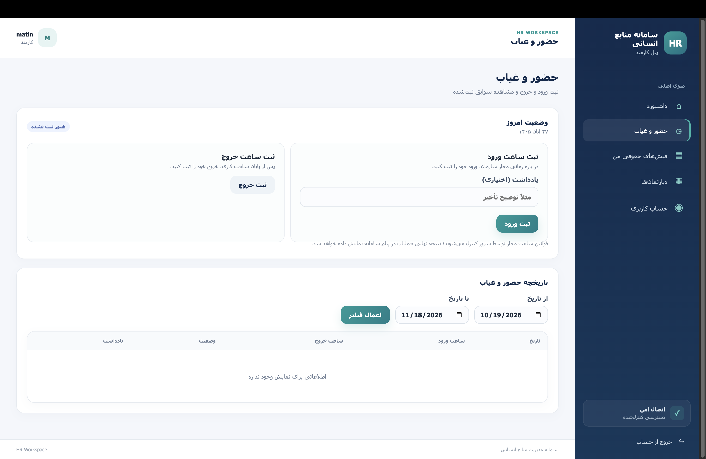
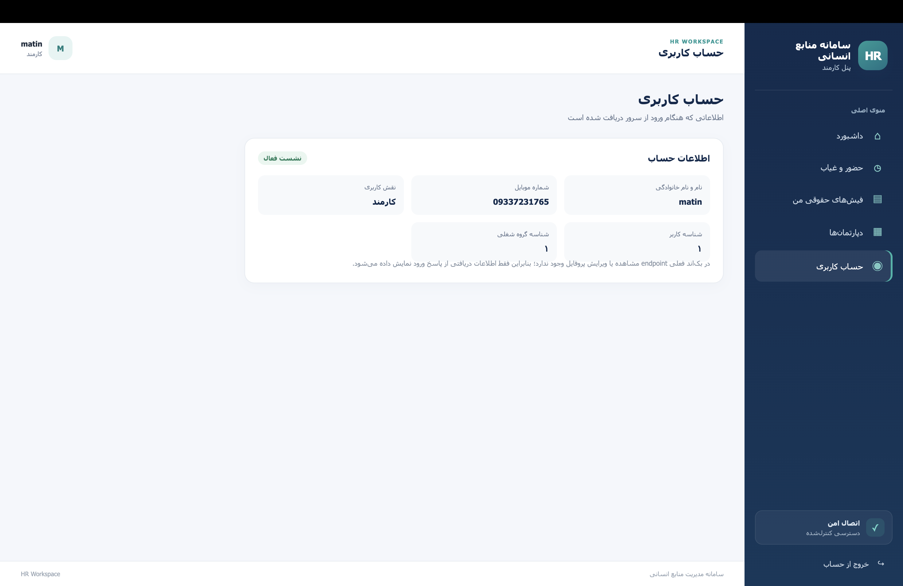

# PeopleFlow — Human Resource Management System

PeopleFlow is a web-based Human Resource Management System built with **NestJS, TypeScript, PostgreSQL, and Redis**. It provides separate manager and employee workspaces for handling departments, employee groups, attendance, and payroll.

The project combines a modular REST API with server-rendered pages powered by EJS.

---

## Table of Contents

- [Screenshots](#screenshots)
- [Features](#features)
- [Authentication and Authorization](#authentication-and-authorization)
- [Attendance and Payroll Automation](#attendance-and-payroll-automation)
- [Backend Architecture](#backend-architecture)
- [Testing](#testing)
- [Technology Stack](#technology-stack)
- [API Overview](#api-overview)
- [Redis Service](#redis-service)
- [Project Structure](#project-structure)
- [Getting Started](#getting-started)
- [Author](#author)

---

## Screenshots

### Manager Workspace

| Dashboard | Departments | Groups & Salary Grades |
|:---:|:---:|:---:|
|  |  |  |

| Payroll Management | Create Manager Account |
|:---:|:---:|
|  |  |

### Employee Workspace

| Dashboard | Attendance |
|:---:|:---:|
|  |  |

| Payroll | Account |
|:---:|:---:|
|  |  |

---

## Features

### Authentication and Authorization

- Employee registration and user login.
- JWT-based authentication with access and refresh tokens.
- Refresh-token rotation.
- Refresh tokens stored as bcrypt hashes in the database.
- Signed, HTTP-only cookies for refresh-token transport.
- Global JWT authentication guard with public-route support.
- Role-based access control for manager and employee routes.

### Manager Workspace

- Manager dashboard and manager account creation.
- Department management (create, list, view, update, and delete).
- Employee group and base-salary management.
- Payroll listing, filtering, viewing, and updating.
- Payroll status, bonuses, deductions, and notes management.

### Employee Workspace

- Employee dashboard and account page.
- Attendance check-in and check-out.
- Personal attendance history with date filtering.
- Access to department information.
- Access to personal payroll records with date filtering.

### Shared Backend Capabilities

- Modular NestJS application structure.
- DTO-based request validation using `class-validator` and `class-transformer`.
- Centralized success-response handling through a custom interceptor.
- Centralized exception handling through a custom exception filter.
- Scheduled background tasks for attendance and payroll processing.
- Event-driven communication between selected services.
- Swagger API documentation with separate manager and employee interfaces.
- Server-rendered EJS pages and static asset delivery.

---

## Authentication and Authorization

PeopleFlow uses JWT access and refresh tokens to protect API routes.

- The global JWT guard protects routes by default; routes marked with the `@Public()` decorator bypass JWT authentication.
- A role guard restricts manager and employee endpoints according to the user's role.
- Passwords and stored refresh tokens are hashed with bcrypt.
- The refresh token is sent through a signed, HTTP-only cookie and rotated when a refresh request succeeds.

The application exposes separate Swagger documentation interfaces for manager and employee APIs.

---

## Attendance and Payroll Automation

### Attendance Processing

Attendance operations include check-in, check-out, and date-based history filtering. Company work dates are calculated using the `Asia/Tehran` time zone.

A scheduled task checks employee attendance records at the end of the configured workday. It creates an absence record when no attendance exists, and marks an existing record as incomplete when a check-out is missing.

### Payroll Generation

A scheduled payroll task processes employee attendance for the payroll period and calculates payroll values using the employee's group and associated base salary.

The calculation considers:

- Present and absent days.
- Overtime hours.
- Undertime hours.
- Base salary.
- Bonuses and deductions.

Managers can review payroll records, filter them by date and status, and update payroll details and payment status. Employees can only retrieve their own payroll records.

---

## Backend Architecture

The application follows NestJS modular architecture and separates HTTP handling from business logic through controllers and services.

```text
Browser
  |
  v
Express + NestJS
  |
  +-----------------------+
  |                       |
  v                       v
EJS Web Pages         REST API
                          |
                          v
                  Global JWT Guard
                          |
                          v
                    Role Guard
                          |
                          v
                   Controllers
                          |
                          v
                    DTO Validation
                          |
                          v
                      Services
                       /    \
                      v      v
                  TypeORM   Redis
                      |
                      v
                  PostgreSQL
```

### Event-Driven Communication

The project uses `@nestjs/event-emitter` to decouple selected service operations. For example, the attendance service emits the `users.find` event asynchronously to retrieve users, while the authentication service handles that event.

### Scheduled Tasks

The project uses `@nestjs/schedule` and cron expressions for recurring operations, including end-of-day attendance processing and monthly payroll generation.

### Web Interface

The `WebModule` renders EJS templates for the browser-based interface. Static files such as CSS and JavaScript are served through `ServeStaticModule`.

---

## Testing

PeopleFlow includes **47 HTTP-level end-to-end test cases across 6 test suites**, implemented with Jest, Supertest, and the NestJS testing utilities.

### Test Suite Breakdown

| Test Suite | Test Cases | Main Coverage |
|---|---:|---|
| `auth.e2e-spec.ts` | 9 | Registration, login, manager creation, refresh flow, and authentication behavior |
| `attendance.e2e-spec.ts` | 8 | Check-in, check-out, attendance filtering, and validation |
| `department-manager.e2e-spec.ts` | 8 | Manager department CRUD operations |
| `department-employee.e2e-spec.ts` | 5 | Employee department access and route permissions |
| `payroll-manager.e2e-spec.ts` | 11 | Base salaries, groups, payroll filtering, retrieval, and updates |
| `payroll-employee.e2e-spec.ts` | 6 | Employee payroll retrieval and date filtering |
| **Total** | **47** | **6 suites** |

### What the Tests Exercise

- Requests pass through a real NestJS HTTP application and the actual controllers.
- The global validation pipe, response interceptor, exception filter, route decorators, and actual role guard are included.
- Tests cover request validation, response behavior, protected routes, and role-based access rules.
- Supertest is used to make HTTP requests against the test application.

### Test Scope and Isolation

The database-backed service classes are mocked. These tests focus on the HTTP and controller layer; they do not execute real PostgreSQL queries or verify the internal implementation of the services.

A test-only JWT guard replaces real JWT signature verification. It supplies test identities for manager and employee requests, while the application's actual role guard still checks route permissions. Therefore, these tests do not validate real JWT signing or verification.

### Running the Tests

Run all E2E suites:

```bash
npm run test:e2e -- --runInBand
```

Run an individual suite:

```bash
npm run test:e2e -- --runInBand test/auth.e2e-spec.ts
```

The remaining test suites can be run by replacing the file path with one of the other `test/*.e2e-spec.ts` files.

For more details about the test setup and coverage, see [test/E2E-README.md](./test/E2E-README.md).

---

## Technology Stack

| Category | Technologies |
|---|---|
| Backend Framework | NestJS |
| Language | TypeScript |
| HTTP Platform | Express |
| Server-side Templates | EJS |
| Database | PostgreSQL |
| ORM | TypeORM |
| In-memory Data Store | Redis |
| Redis Client | ioredis |
| Authentication | JWT, Passport, passport-jwt |
| Password and Token Hashing | bcrypt |
| Validation | class-validator, class-transformer |
| Scheduled Tasks | @nestjs/schedule |
| Event Handling | @nestjs/event-emitter |
| API Documentation | Swagger |
| HTTP Testing | Jest, Supertest |
| Code Quality and Formatting | Oxlint, Prettier |

---

## API Overview

All REST API routes use the global prefix:

```text
/api/v1
```

The following table lists the main endpoints. Protected routes require authentication, and manager or employee routes additionally enforce their respective roles.

### Authentication

| Method | Endpoint | Description |
|---|---|---|
| POST | `/api/v1/auth/register` | Register an employee |
| POST | `/api/v1/auth/login` | Authenticate a user |
| POST | `/api/v1/auth/create-manager` | Create a manager account (manager only) |
| POST | `/api/v1/auth/refresh/user/:id` | Refresh a user's tokens |

### Attendance

| Method | Endpoint | Description |
|---|---|---|
| POST | `/api/v1/attendance/checkin` | Record employee check-in |
| GET | `/api/v1/attendance/checkout` | Record employee check-out |
| POST | `/api/v1/attendance` | Retrieve attendance records with optional date filters |

### Departments

| Method | Endpoint | Description |
|---|---|---|
| POST | `/api/v1/manager-data/departments` | Create a department (manager only) |
| GET | `/api/v1/manager-data/departments` | List departments (manager only) |
| GET | `/api/v1/manager-data/departments/:id` | Retrieve a department (manager only) |
| PATCH | `/api/v1/manager-data/departments/:id` | Update a department (manager only) |
| DELETE | `/api/v1/manager-data/departments/:id` | Delete a department (manager only) |
| GET | `/api/v1/employee-data/departments` | List departments (employee only) |
| GET | `/api/v1/employee-data/departments/:id` | Retrieve a department (employee only) |

### Manager Payroll

| Method | Endpoint | Description |
|---|---|---|
| POST | `/api/v1/manager/payrolle/base-salary` | Create a base salary |
| POST | `/api/v1/manager/payrolle/groups` | Create an employee group |
| GET | `/api/v1/manager/payrolle/groups` | List employee groups |
| PATCH | `/api/v1/manager/payrolle/groups/:groupId/base-salary/:baseSalaryId` | Change a group's base salary |
| GET | `/api/v1/manager/payrolle` | List and filter payroll records |
| GET | `/api/v1/manager/payrolle/:id` | Retrieve a payroll record |
| PATCH | `/api/v1/manager/payrolle/:id` | Update a payroll record |

### Employee Payroll

| Method | Endpoint | Description |
|---|---|---|
| GET | `/api/v1/employee/payrolle` | List the authenticated employee's payroll records |
| GET | `/api/v1/employee/payrolle/:id` | Retrieve one of the authenticated employee's payroll records |

### Swagger Documentation

- Manager API: `/api/manager`
- Employee API: `/api/employee`

---

## Redis Service

The project includes a reusable Redis service built with `ioredis`. It provides helpers for:

- Setting and retrieving string values.
- Storing and retrieving JSON values.
- Deleting keys and checking whether keys exist.
- Setting expiration in seconds or milliseconds.
- Reading TTL and PTTL values.
- Removing key expiration with `PERSIST`.
- Incrementing and decrementing numeric values.
- Retrieving remaining key lifetime in `MM:SS` format.
- Checking the Redis connection during module initialization and closing it during module destruction.

---

## Project Structure

The main application structure is organized as follows:

```text
src/
├── common/
│   ├── filter/
│   │   └── error.filter.ts
│   └── interceptors/
│       └── response.interceptors.ts
├── module/
│   ├── attendance/
│   ├── auth/
│   ├── department/
│   ├── payroll/
│   └── redis/
├── public/
│   ├── css/
│   └── js/
├── shared/
├── views/
│   ├── auth/
│   └── errors/
├── web/
├── app.module.ts
└── main.ts
test/
├── e2e-support/
├── *.e2e-spec.ts
├── E2E-README.md
└── jest-e2e.json
screenshots/
README.md
.env.example
```

---

## Getting Started

### Prerequisites

Make sure the following are installed and available:

- Node.js and npm
- PostgreSQL
- Redis

### 1. Clone the Repository

```bash
git clone https://github.com/benyamin-haghighy/PeopleFlow.git
cd PeopleFlow
```

### 2. Install Dependencies

```bash
npm install
```

### 3. Configure Environment Variables

Copy the example environment file:

```bash
cp .env.example .env
```

Update `.env` with your local PostgreSQL connection details, JWT secrets, cookie secret, Redis connection settings, and application port.

The application expects the environment variable names defined in `.env.example`. Keep real credentials and secrets private; do not commit your local `.env` file.

### 4. Start PostgreSQL and Redis

Make sure both services are running and that the database specified in `.env` is available.

### 5. Run the Application

Start in development mode:

```bash
npm run start:dev
```

Build the application:

```bash
npm run build
```

Run the production build:

```bash
npm run start:prod
```

The application listens on the port configured through the `PORT` environment variable (the code uses `3001` as its fallback).

---

## Author

**Benyamin Haghighy**

Backend Developer | Node.js · TypeScript · NestJS

- GitHub: [@benyamin-haghighy](https://github.com/benyamin-haghighy)
- Email: bng2003@gmail.com

---

**PeopleFlow** — A web-based platform for human resource management.
